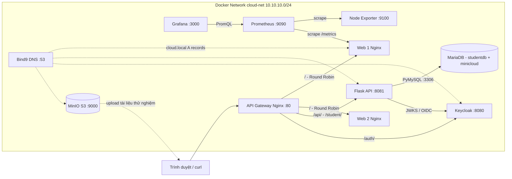

# SƠ ĐỒ KIẾN TRÚC MYMINICLOUD

## Sơ đồ thành phần (Mermaid)

> Tổng cộng 11 container: 9 loại server + Node Exporter + Web 2. Grafana thể hiện metrics/visualization, chưa lưu log tập trung bằng Loki.

## Luồng request

1. Client gọi `http://localhost/`: Nginx Gateway gửi luân phiên Web 1 / Web 2 (Round Robin). Cả hai cùng có blog, ảnh, CSS.
2. Client gọi `http://localhost/api/students-db`: Gateway bỏ prefix `/api/`, Flask dùng `MARIADB_USER` và `MARIADB_PASSWORD` đọc `studentdb.students`.
3. Client lấy access token từ Keycloak Realm rồi gọi `/api/secure` với header `Authorization: Bearer ...`; Flask đọc JWKS nội bộ, xác thực chữ ký, `iss`, `aud`.
4. Prometheus scrape `/metrics` Web 1 và Node Exporter; Grafana truy vấn Prometheus để vẽ ba biểu đồ CPU/RAM/Network.
5. Bind9 cung cấp zone `cloud.local` theo IP tĩnh trong Docker Compose. MinIO độc lập lưu avatar và PDF; chưa nối thành một chức năng upload qua Flask, không nên mô tả là đã tích hợp API upload S3.

## Phân chia mạng và port host

| Service | IP `cloud-net` | Port container | Host |
|---|---|---|---|
| web-frontend-server | 10.10.10.10 | 80 | 127.0.0.1:8080 |
| web-frontend-server2 | 10.10.10.11 | 80 | không xuất bản |
| application-backend-server | 10.10.10.20 | 8081 | 127.0.0.1:8085 |
| relational-database-server | 10.10.10.25 | 3306 | không xuất bản |
| object-storage-server | 10.10.10.30 | 9000,9001 | 127.0.0.1:9000,9001 |
| authentication-identity-server | 10.10.10.40 | 8080 | 127.0.0.1:8081 |
| internal-dns-server | 10.10.10.50 | 53 UDP/TCP | 127.0.0.1:1053 |
| node-exporter | 10.10.10.60 | 9100 | không xuất bản |
| monitoring-prometheus-server | 10.10.10.61 | 9090 | 127.0.0.1:9090 |
| monitoring-grafana-dashboard-server | 10.10.10.62 | 3000 | 127.0.0.1:3000 |
| api-gateway-proxy-server | 10.10.10.70 | 80 | **0.0.0.0:80** |
